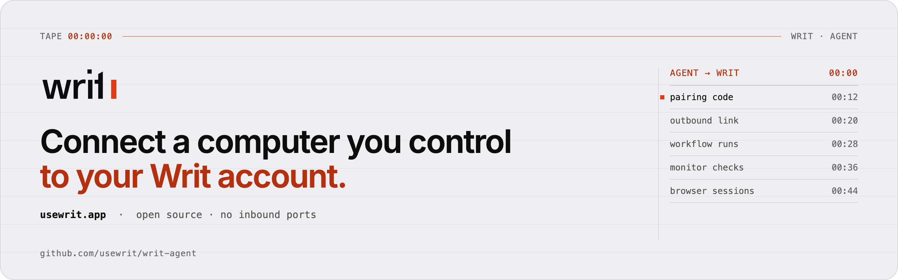
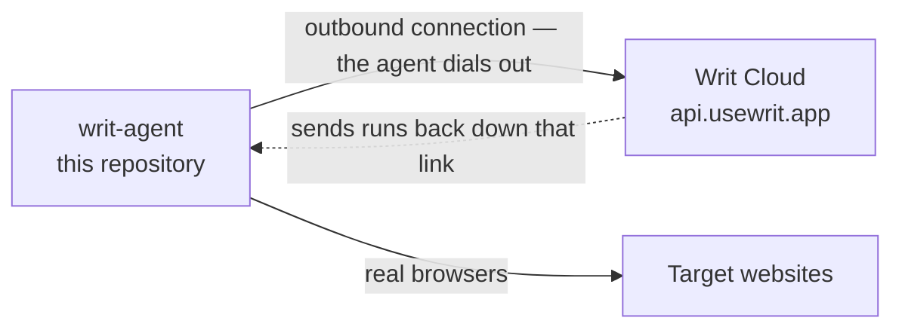

<div align="center">
  <a href="https://usewrit.app"><picture>
    <source media="(prefers-color-scheme: dark)" srcset="./assets/cover-dark.png">
    
  </picture></a>

  <br/>

  <p align="center">
    <a href="https://github.com/usewrit/writ-agent/actions/workflows/ci.yml"></a>
    <a href="https://github.com/usewrit/writ-agent/releases"></a>
    <a href="./LICENSE"></a>
    
  </p>

  <h3 align="center">Connect a computer or server you control to your Writ account.</h3>

  <p align="center">
    <a href="https://usewrit.app"><b>usewrit.app</b></a> ·
    <a href="https://usewrit.app/docs/agents/"><b>Docs</b></a> ·
    <a href="#quick-start"><b>Quick start</b></a> ·
    <a href="#what-it-does"><b>What it does</b></a> ·
    <a href="#what-it-talks-to"><b>What it talks to</b></a> ·
    <a href="./docs/CONFIGURATION.md"><b>Configuration</b></a> ·
    <a href="./SECURITY.md"><b>Security</b></a>
  </p>
</div>

---

**writ-agent** is a small program with no interface. It connects a computer or a server you control
to your [Writ](https://usewrit.app) account, takes the work your account sends it (workflow runs,
monitor checks and browser sessions), and runs it on that machine: with its browser, its network and
its IP address. It is open source.

> **Writ Desktop is the recommended machine.** [Writ Desktop](https://usewrit.app/desktop) is the
> full app: Scribe, the recorder, an encrypted vault, and workflows that keep running offline. Link
> it to your account and it receives the runs you allow it to take. Use writ-agent when you want a
> machine with no interface, such as an always-on server. This repository is the agent only; you
> build and manage your APIs in the Writ app.

## Why run your own agent

- **The browsing happens on your machine.** Cookies, sessions, logins and page content stay on the
  host you started the agent on, and the sites see your machine's network and IP address.
- **No inbound ports.** The agent opens one outbound connection to Writ. It works behind NAT, on a
  laptop, in a container: no firewall holes, no public DNS.
- **One pairing code, no token to paste.** The install command carries a single-use pairing code, so
  no account token is ever pasted into a terminal.
- **Unpack and run.** One binary and the browser driver that ships beside it in the same archive.
  Chromium installs itself on first use.
- **Open source, AGPL-3.0.** Read it, fork it, run it.

## What it does

| | Capability |
| --- | --- |
| **Run** | Replays the workflows your account sends it and returns structured data. |
| **Monitor** | Runs the change and uptime checks assigned to this machine. |
| **Browse** | Opens the browser sessions your account asks for, on this machine. |

The agent has no recorder, assistant or vault (those are Writ Desktop features), and it works only
while it is connected to your account.

## How it fits together



The arrow direction is the point: **the agent connects to Writ**, never the other way round. Nothing
needs to reach the machine from outside; Writ sends work back down the connection the agent already
opened.

---

## Quick start

### 1. Connect a machine

In Writ Cloud, open **Agents** (under **Connect** in the sidebar), click **Connect a machine** and
choose **Open-source agent**. Pick the system of the machine: macOS, Linux or Windows. Click **Get
the install command**. Writ creates a **Pairing code** for this command. It works once and expires
after 15 minutes; **Generate a new one** if it does.

### 2. Run the command on the machine

Copy the command from the page and run it in a terminal on that machine. It installs the agent,
connects it to your account and starts it. The machine appears in the list a few seconds later.

macOS and Linux (`WRIT-4K2P-9XQ` stands for your pairing code):

```sh
curl -fsSL https://api.usewrit.app/agent.sh | sh -s -- WRIT-4K2P-9XQ
```

Windows (PowerShell):

```powershell
& ([scriptblock]::Create((irm https://api.usewrit.app/agent.ps1))) WRIT-4K2P-9XQ
```

On macOS and Linux the script downloads the build for your system (macOS arm64 or x86_64, Linux
x86_64 or aarch64) from this repository's [Releases](https://github.com/usewrit/writ-agent/releases),
checks its SHA-256, and puts it in `~/.writ` (`$WRIT_HOME` when set), next to its browser driver. The
agent's log is `~/.writ/agent.log`. The pairing code is exchanged for the agent's credentials, so
there is nothing else to configure.

### 3. Send work to it

Send work to it the same way as to any of your machines: in a workflow's **Call** tab, set the
execution target to **Local agent** or **Auto (local, else cloud)**.

### Good to know

- The agent starts as a normal program, not as a system service, so restart it after the machine
  reboots.
- Each plan connects a number of machines at once. At the limit, the Agents page shows **Machine
  limit reached** and a new pairing code is refused. Disconnect a machine from the Agents page, or
  click **Upgrade plan**.
- To disconnect a machine, open its row's actions on the Agents page and click **Disconnect**. It
  stops receiving new work at once.

More in the documentation: [Your own machines](https://usewrit.app/docs/agents).

### Install without enrolling

To get the binary without connecting it (for example to start it from your own tooling), run the
same script with `--download-only`:

```sh
curl -fsSL https://api.usewrit.app/agent.sh | sh -s -- --download-only
```

It prints how to start the agent. The agent is configured entirely by environment variables; every
setting is documented in [`docs/CONFIGURATION.md`](./docs/CONFIGURATION.md). The ones you will meet
first:

| Variable | Meaning |
|----------|---------|
| `WRIT_SERVICE_TOKEN` | The bearer the agent connects with. The install command fills it in for you. |
| `WRIT_COORDINATOR_URL` | The Writ address the agent connects to: `https://api.usewrit.app`. (The name is historical.) |
| `WRIT_HOME` | Data directory (default `~/.writ`): holds the encrypted database and key file. |
| `WRIT_USE_KEYRING` | Root the encryption key in the OS keyring instead of a key file. |
| `WRIT_FLEET_STATUS_PORT` | Serve a loopback-only health endpoint on this port (see below). |

### Health endpoint

Set `WRIT_FLEET_STATUS_PORT=<port>` and the agent serves a **loopback-only** (`127.0.0.1`)
endpoint: `GET /healthz` returns `{status, connected, uptime_s, last_task_at, version}` and answers
HTTP `503` while disconnected from Writ. Point a systemd watchdog or a monitoring probe at it.

### Running more work per host

An agent takes a small number of background runs at a time by default. You can raise that — see
`WRIT_MAX_CONCURRENT_RUNS` and `WRIT_MAX_BACKGROUND_RUNS` in
[`docs/CONFIGURATION.md`](./docs/CONFIGURATION.md) — or connect more machines. Each agent is
independent of the others; give each its own `WRIT_HOME`.

---

## What it talks to

The agent makes **no** outbound calls you did not configure.

| Destination | When |
|-------------|------|
| Writ Cloud (`api.usewrit.app`) | Always — the one link it opens. TLS verified; sending the token in plaintext to a remote host is refused. |
| The Chromium project's download bucket | First browser use only, if no browser is found. The agent fetches open-source Chromium over HTTPS and verifies it against a checksum built into the binary, refusing to install on a mismatch. Pre-install into `PLAYWRIGHT_BROWSERS_PATH` to skip it. |
| The sites your workflows target | When they run. |

There is no update check, and telemetry opens no destination of its own. Anonymous usage counts —
totals and durations, never page content or URLs — ride the connection to Writ you already
configured. Crash reporting stays inert unless you supply your own `WRIT_TELEMETRY_DSN` — there is
no built-in one.

For the finer points — what monitoring stores, how long data is kept, what the browser flags do —
see [`docs/DISCLOSURES.md`](./docs/DISCLOSURES.md).

## Security

- The machine opens the connection to Writ itself. You open no inbound port.
- The install uses a single-use pairing code, so no account token is ever pasted into a terminal.
- Personas saved in Writ Cloud sign in on Writ Cloud. Their secrets are not sent to your connected
  machines. Sign-ins saved in Writ Desktop stay in that computer's own vault and sign in from there.
- Your data lives in an **encrypted database** on your own disk; the key is held either in the OS
  keyring or a `0600` file inside a `0700` directory. Individual secrets are sealed separately.
- TLS is verified. There is no certificate bypass for the Writ link.
- Logs pass through a redaction layer before anything is written.

Writ runs on your own accounts, with your own credentials and data, on sites you are authorized to
use.

To report a vulnerability, use GitHub's private **"Report a vulnerability"** flow on this
repository — see [`SECURITY.md`](./SECURITY.md). Please do not open a public issue for security
reports.

## Community & support

- **Questions, setup help, show & tell** — [GitHub Discussions](https://github.com/usewrit/writ-agent/discussions).
- **Bugs & feature requests** — [GitHub Issues](https://github.com/usewrit/writ-agent/issues).
- **Your account, plan and machines** — [usewrit.app/contact](https://usewrit.app/contact) or support@usewrit.app.
- **Security issues** — report privately, see [`SECURITY.md`](./SECURITY.md).

## Contributing

Issues and pull requests are welcome — start with [`CONTRIBUTING.md`](./CONTRIBUTING.md) and the
[Code of Conduct](./CODE_OF_CONDUCT.md). Released changes are recorded in
[`CHANGELOG.md`](./CHANGELOG.md).

## License

Copyright © 2026 The Writ Project Authors.

Licensed under the **GNU Affero General Public License, version 3** (`AGPL-3.0-only`) — see
[`LICENSE`](./LICENSE).

**AGPL-3.0 §13 — the network source offer.** If you modify this agent and let anyone else interact
with it over a network, you owe them the complete corresponding source of **your** modified version.

Third-party license notices for Rust dependencies are in
[`THIRD_PARTY_NOTICES.md`](./THIRD_PARTY_NOTICES.md); the programs redistributed as binaries (the
browser drivers, Node.js, Chromium) are attributed in
[`BUNDLED_BINARIES.md`](./BUNDLED_BINARIES.md). All are permissively licensed and shipped
unmodified; **no dependency of this project is AGPL** — that license is ours alone.

The Writ name, wordmark, glyph and tile are trademarks and are **not** covered by the AGPL grant —
read that file before rebranding a fork.
